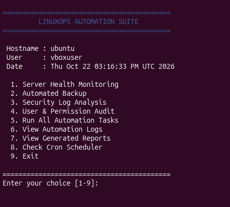
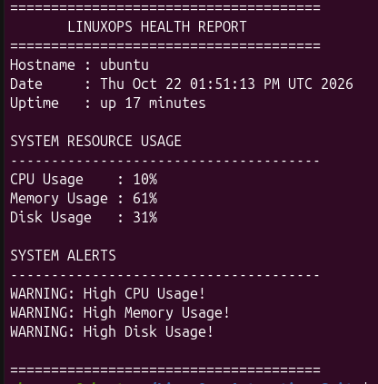
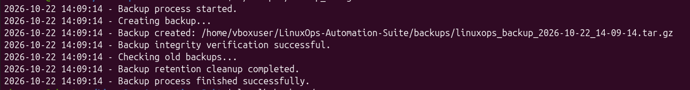
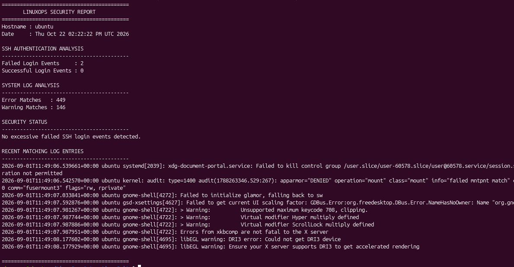
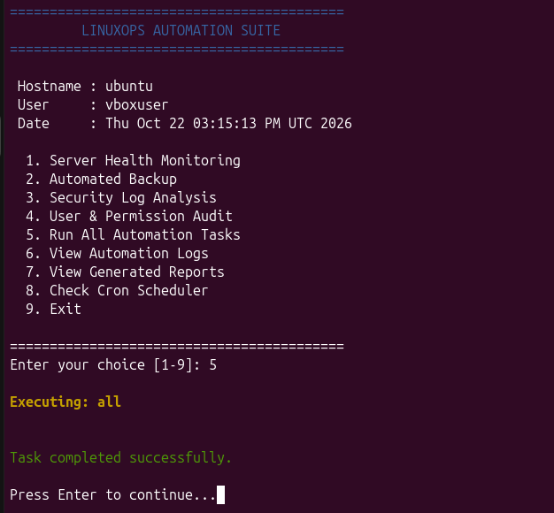

# LinuxOps Automation Suite

### Automated Linux Server Administration, Monitoring & Recovery Platform

LinuxOps Automation Suite is a Bash-based Linux administration
project designed to automate routine server maintenance,
monitoring, backup operations, and security auditing.

## Features

- Automated CPU, memory and disk monitoring
- Configurable resource thresholds
- Compressed and timestamped backups
- Backup integrity verification
- Backup restoration testing
- Linux security log analysis
- SSH authentication event detection
- User and permission auditing
- Automated cron scheduling
- Interactive terminal dashboard
- Execution logging and report generation

## Technology Stack

- Ubuntu Linux
- Bash Scripting
- Linux CLI Utilities
- Cron
- Git and GitHub
- ShellCheck

## Project Structure

```text
LinuxOps-Automation-Suite/
├── scripts/
│   ├── health_monitor.sh
│   ├── backup_manager.sh
│   ├── log_analyzer.sh
│   ├── user_audit.sh
│   └── automation_runner.sh
├── config/
│   └── linuxops.conf
├── tests/
├── demo_data/
├── logs/
├── reports/
├── backups/
├── docs/
│   └── screenshots/
├── linuxops.sh
├── install.sh
├── .gitignore
└── README.md
```

## Installation

Tested on Ubuntu Linux.

Install dependencies:

```bash
sudo apt update
sudo apt install git cron sysstat shellcheck -y
```

Clone the repository:

```bash
git clone YOUR_REPOSITORY_URL
cd LinuxOps-Automation-Suite
```

Install:

```bash
chmod +x install.sh
./install.sh
```

## Launch Dashboard

```bash
./linuxops.sh
```

## Automation Schedule

| Task | Schedule |
|---|---|
| Health monitoring | Every 5 minutes |
| Security analysis | Every hour |
| Automated backup | Daily at 2 AM |
| User auditing | Daily at 3 AM |

Cron jobs must be configured separately using the
instructions in the project documentation.

## Screenshots

## Screenshots

### Main Dashboard


### Health Monitoring


### Backup Automation


### Security Monitoring


### Central Automation


## Security Considerations

- Automation runs using the executing user's permissions.
- Generated logs, backups and reports are excluded from Git.
- Production backups should also be stored off-server.
- Backup restoration should be tested periodically.
- Security event detection is based on matching log patterns.

## Author

Linux Administration & DevOps Portfolio Project
